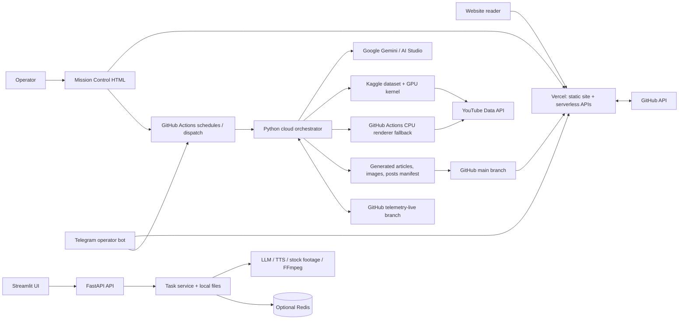

# The Bull Print — Architecture

## 1. System overview

The repository is a hybrid monorepo containing three related but operationally distinct systems:

1. **Public market-information website** — static HTML/CSS/JavaScript and JSON content served by Vercel, with serverless API routes.
2. **Automated content-production and publishing system** — Python pipelines coordinated primarily by GitHub Actions, with Gemini-based content generation, a Kaggle GPU worker, a CPU rendering fallback, and YouTube/site distribution.
3. **General-purpose video-generation application** — a local/Docker FastAPI API and Streamlit UI for creating videos from user-supplied topics or scripts.

There is no single shared application server or central database spanning all three. The systems share some Python services and repository content, but have separate entry points, state stores, and operational models.

The diagram summarizes the principal paths visible in the source and workflows. Optional integrations and alternate scripts are described below; not every integration is active in every deployment.

## 2. Public website and API layer

### Website

The front end is a set of standalone static pages rather than a single React/Next.js application. The home market dashboard is [`index.html`](index.html); other notable pages include [`stock.html`](stock.html), [`article.html`](article.html), [`articles.html`](articles.html), [`screener.html`](screener.html), and pages for finance categories and tools. Shared styling and theme/auth behavior live under [`brand_assets/`](brand_assets/).

The browser-side [`app.js`](app.js) loads the published article/video feed from [`content/posts.json`](content/posts.json) and renders the home-page content. Article and stock pages also fetch data from the serverless APIs as needed.

[`vercel.json`](vercel.json) configures clean URLs, rewrites, and response headers. It maps routes such as `/article/:slug`, `/stocks/:symbol`, `/screener`, and `/mission-control` to static pages, and maps named Mission Control endpoints to their API implementations.

### Serverless APIs

The root [`api/`](api/) directory contains Vercel functions used by the site and operations tooling:

- [`api/quote.js`](api/quote.js) — quote proxy with Yahoo Finance ticker fallbacks.
- [`api/screener.js`](api/screener.js) — fetches and parses company fundamentals from Screener.in.
- [`api/go.js`](api/go.js) — affiliate redirect and best-effort click telemetry through a GitHub Actions repository variable.
- [`api/telegram-webhook.js`](api/telegram-webhook.js) — Telegram command and callback handler; reads status/content and can dispatch GitHub workflows.
- [`api/mission-control/auth.js`](api/mission-control/auth.js) — operator login/session endpoint.
- [`api/mission-control/telemetry.js`](api/mission-control/telemetry.js) — combines workflow and Git-backed state for the dashboard.
- [`api/mission-control/action.js`](api/mission-control/action.js) — dispatches workflows or writes operator commands.

[`mission-control.html`](mission-control.html) is the operator dashboard. It periodically requests telemetry and submits actions through the Mission Control APIs. It is a control/observability surface, not the production worker itself.

A separate TypeScript Telegram route exists at [`app/api/telegram-webhook/route.ts`](app/api/telegram-webhook/route.ts). The repository also contains [`api/telegram-webhook.js`](api/telegram-webhook.js); the Vercel rewrites explicitly cover Mission Control routes but do not specify a special rewrite for these two webhook implementations. Confirm deployment routing/configuration before treating them as interchangeable.

## 3. Automated publishing system

### Orchestration and triggers

GitHub Actions is the principal scheduler and cloud execution environment:

- [`.github/workflows/market_publisher.yml`](.github/workflows/market_publisher.yml) contains scheduled article and video jobs, plus manual dispatch inputs. Job conditions separate article slots from video slots.
- [`.github/workflows/auto_engine.yml`](.github/workflows/auto_engine.yml) handles manual and external `repository_dispatch` video triggers.
- [`.github/workflows/self_healer_watchdog.yml`](.github/workflows/self_healer_watchdog.yml) starts the watchdog on a timer and after relevant workflow runs.
- [`.github/workflows/weekly_revenue_report.yml`](.github/workflows/weekly_revenue_report.yml) sends a weekly operations/content digest.

For the main video workflow, the central implementation is [`cloud_orchestrator.py`](cloud_orchestrator.py). Batch entry points such as [`scripts/publish_all_12_videos.py`](scripts/publish_all_12_videos.py), [`run_batch_shorts.py`](run_batch_shorts.py), and [`run_batch_longform.py`](run_batch_longform.py) invoke it for multiple slots. Batch counts and slot sets are defined by those scripts and workflow inputs; they are not equivalent to the ordinary daily schedule.

### Video production flow

The cloud video path is approximately:

1. **Resolve request/slot.** Workflow inputs or a scheduled slot provide the vertical, topic/notes, slot number, and Shorts count.
2. **Initialize run tracking.** The orchestrator creates an editable Telegram status card and starts [`app/services/telemetry_bridge.py`](app/services/telemetry_bridge.py) for progress and control synchronization.
3. **Select a topic.** It may load performance recommendations from [`app/services/viral_growth_agent.py`](app/services/viral_growth_agent.py) and harvest search intent through [`app/services/seo_topic_harvester.py`](app/services/seo_topic_harvester.py), falling back to configured slot topics.
4. **Gather visuals and generate content.** It captures charts/infographics, then requests a structured script, metadata, Shorts, and article payload from Gemini/AI Studio.
5. **Audit and revise.** Content passes through virality, compliance, and authenticity checks, notably [`app/services/viral_script_doctor.py`](app/services/viral_script_doctor.py), [`app/services/compliance_gate.py`](app/services/compliance_gate.py), and [`app/services/content_authenticity_engine.py`](app/services/content_authenticity_engine.py). Some checks regenerate or sanitize rejected content; an authenticity failure can halt the run. These are software gates, not a legal or regulatory certification.
6. **Create thumbnails.** [`thumbnail_generator.py`](thumbnail_generator.py) composes marketing images. The orchestrator can wait for operator approval, regeneration, or halt commands before rendering.
7. **Render and upload.** By default, the workflow stages the payload and assets in `kaggle_stage/`, updates the Kaggle dataset, and launches the kernel described by [`kaggle_kernel/kernel-metadata.json`](kaggle_kernel/kernel-metadata.json). [`kaggle_kernel/kaggle_worker.py`](kaggle_kernel/kaggle_worker.py) performs remote audio/subtitle/video work and YouTube upload. If Kaggle is bypassed, unavailable, or fails, the orchestrator can use [`app/services/local_cpu_renderer.py`](app/services/local_cpu_renderer.py) and [`app/services/short_renderer.py`](app/services/short_renderer.py) on the GitHub Actions runner.
8. **Publish and distribute.** The orchestrator generates an article through [`engine.py`](engine.py), updates publication metadata through [`publisher.py`](publisher.py), and performs the configured indexing and social/YouTube follow-up actions. The workflow commits generated content/assets to GitHub; a repository update triggers the Vercel site deployment.

The Kaggle dataset is a **file handoff for a render job**, not persistent application storage. GitHub Actions coordinates the transfer and execution; the worker runs in Kaggle's environment and uploads through the YouTube Data API.

### Market/article publishing flow

A second production path is centered on [`app/services/autonomous_scheduler.py`](app/services/autonomous_scheduler.py) and [`app/services/pipeline_orchestrator.py`](app/services/pipeline_orchestrator.py):

1. The scheduler resolves an IST market slot and invokes a market cycle.
2. [`app/services/market_data.py`](app/services/market_data.py) builds a market context from index, quote, sector, macro, and flow data using sources including yfinance/Yahoo endpoints and public market endpoints.
3. The orchestrator attempts video generation/upload with retries and diagnostic remedies.
4. [`app/services/article_generator.py`](app/services/article_generator.py) creates an article; [`app/services/qa_critic.py`](app/services/qa_critic.py) evaluates/refines it.
5. The article publisher is selected from configuration: [`app/services/github_publisher.py`](app/services/github_publisher.py) or [`app/services/wp_publisher.py`](app/services/wp_publisher.py). The orchestrator can then add the article backlink to YouTube and send a notification.

The scheduled workflow in `market_publisher.yml` invokes this scheduler for article slots. This flow is distinct from the Gemini master-payload flow in `cloud_orchestrator.py`, even though they share the repository and some service integrations.

## 4. Operations, telemetry, and control plane

### Mission Control and Telegram

Mission Control and Telegram are operator-facing interfaces to GitHub Actions and Git-backed run state:

- Mission Control authenticates an operator, requests telemetry, and posts actions to Vercel serverless functions.
- The telemetry API reads GitHub Actions runs and JSON files from the `telemetry-live` branch. It also reads the public posts manifest and other stored telemetry artifacts.
- The action API can dispatch workflows, cancel runs, or write a slot command file.
- The cloud orchestrator polls slot commands during relevant stages (for example, thumbnail approval/regeneration and halt) and acknowledges commands by clearing them.
- Telegram commands can request status, trigger production, initiate a watchdog run, and dispatch supported workflows.

### Git-backed state

[`app/services/telemetry_bridge.py`](app/services/telemetry_bridge.py) synchronizes JSON state through the GitHub Contents API, with a local Git worktree fallback. The `telemetry-live` branch acts as a lightweight state/control channel. Its files include slot summaries/details, active and published video records, and per-slot commands under `control/`.

This mechanism is not a transactional database. Concurrent writes, API conflicts, eventual visibility, and file-level read/modify/write behavior are operational characteristics to keep in mind.

## 5. Storage and data ownership

| Data | Primary location/mechanism | Purpose |
|---|---|---|
| Public pages and static assets | Repository files on `main`, served by Vercel | Website UI and static resources |
| Published content index | [`content/posts.json`](content/posts.json), committed to `main` | Browser feed and article/video metadata |
| Generated article files and images | `content/`, `assets/`, and selected output paths, committed by workflows | Website publication and supporting media |
| Production progress and operator commands | JSON files on `telemetry-live` | Dashboard status and worker-to-operator control |
| Affiliate click counters | GitHub Actions repository variable | Best-effort aggregate click counts |
| Workflow execution history | GitHub Actions | Scheduling, dispatch, logs, and run status |
| Render inputs | Kaggle dataset and staged files | Temporary job input handoff |
| Render intermediates | GitHub Actions/Kaggle local disks | Audio, charts, thumbnails, and video files during a run |
| Local video task records | In-memory or optional Redis state | Status of FastAPI video-generation tasks |
| Local video outputs and uploaded materials | `storage/` filesystem | Per-task files, local footage, and BGM |
| Hermes agent knowledge/state | Local SQLite/files where that tool is used | Separate agent/pipeline memory, not shared production storage |

The content pipeline also keeps some local JSON memory/cache files, including viral-growth and competitor-radar data. Some services synchronize selected memory to the telemetry branch. These are separate from the local FastAPI task state.

## 6. General-purpose video application

The original configurable video generator is a separate local/Docker application:

- [`main.py`](main.py) starts Uvicorn with the FastAPI app in [`app/asgi.py`](app/asgi.py).
- [`app/router.py`](app/router.py) registers the v1 routers; [`app/controllers/v1/video.py`](app/controllers/v1/video.py) provides video/audio/subtitle generation, task query/deletion, material/BGM upload, and media streaming/download endpoints under `/api/v1`.
- [`app/controllers/v1/llm.py`](app/controllers/v1/llm.py) exposes script and search-term generation.
- [`app/models/schema.py`](app/models/schema.py) defines input/output models and render parameters.
- [`app/services/task.py`](app/services/task.py) coordinates script generation, TTS, subtitles, stock/local materials, video composition, optional multilingual output, and configured uploads.
- Rendering and provider work is split across [`app/services/llm.py`](app/services/llm.py), [`material.py`](app/services/material.py), [`voice.py`](app/services/voice.py), [`subtitle.py`](app/services/subtitle.py), and [`video.py`](app/services/video.py).
- Task queue concurrency is handled by [`app/controllers/manager/`](app/controllers/manager/); state and queue backends can be in-memory or Redis depending on configuration.
- [`webui/Main.py`](webui/Main.py) is the Streamlit interface.

[`docker-compose.yml`](docker-compose.yml) runs the Streamlit UI and FastAPI API as separate services. [`docker-compose.gpu.yml`](docker-compose.gpu.yml) is an optional GPU override. This deployment model is independent of Vercel and the GitHub Actions production orchestrator.

The API's task-state backend and task output files are local/Redis-backed, not the `telemetry-live` production state. Some authentication dependencies in the API controllers are commented out; do not assume those routes are protected without reviewing the effective deployment configuration.

## 7. Alternate, legacy, and experimental paths

The repository contains additional runnable orchestration approaches, including [`run_pipeline.py`](run_pipeline.py), [`master_engine.py`](master_engine.py), [`pipeline_comprehensive.py`](pipeline_comprehensive.py), [`hermes_orchestrator.py`](hermes_orchestrator.py), [`app/services/orchestrator.py`](app/services/orchestrator.py), and [`run_weekly_market_update.py`](run_weekly_market_update.py). They contain alternate combinations of local CPU, Colab, Kaggle, Hermes, and FFmpeg workflows. Their presence does not mean they are invoked by the current scheduled GitHub Actions path; trace workflow and script invocations before treating any one as production-active.

There are also multiple article-generation and publishing implementations. In particular, `cloud_orchestrator.py` uses the root-level `engine.py`/`publisher.py` path, while the market-cycle orchestrator uses the service-level article publisher selection. They overlap in purpose but differ in interfaces and data formats.

Deployment-related files include the local Docker configurations, [`Dockerfile.engine`](Dockerfile.engine), [`.github/workflows/docker_build.yml`](.github/workflows/docker_build.yml), and [`deploy_oracle.sh`](deploy_oracle.sh). These provide alternate container or self-hosted deployment paths; they are not prerequisites for the Vercel/GitHub Actions/Kaggle flow.

## 8. External services and trust boundaries

Principal external dependencies in the inspected flows are:

- **Vercel** — static site hosting and serverless functions.
- **GitHub** — source/content repository, Actions scheduling/execution, API dispatch, and telemetry/control JSON.
- **Google Gemini / AI Studio** — script/article payload generation and some audits.
- **Kaggle** — optional GPU kernel execution and dataset-based payload transfer.
- **YouTube Data API v3** — video upload and channel actions through OAuth credentials.
- **Market/media sources** — Yahoo Finance/yfinance, NSE and Screener.in endpoints, Pexels, and charting/browser-capture sources.
- **Notifications/distribution** — Telegram and optional WhatsApp/X/WordPress integrations, depending on configured credentials.

Credentials should be supplied through the relevant platform secret stores or private local configuration. The codebase includes fallback credential values in some files and the local checkout may contain ignored credential/config artifacts. Treat those as sensitive; do not copy them into documentation, commit them, or assume that a fallback value is safe. The architecture document intentionally does not reproduce any credential values.

## 9. Key architectural characteristics

- **File-and-workflow centric:** GitHub branches, Actions, JSON manifests, and staged files substitute for a shared database/queue in the publishing operation.
- **Multiple production paths:** the cloud master-payload publisher, market-cycle publisher, and local video app are related but distinct systems.
- **Best-effort observability:** dashboard data is assembled from GitHub and local/static values; not every metric is measured live.
- **Fallback-oriented rendering:** Kaggle GPU work can fall back to CPU rendering, while some optional publishing integrations can be skipped when credentials are absent.
- **Static-first website:** the public site consumes committed files and lightweight serverless functions rather than depending on the local FastAPI service.
- **Configuration-dependent security:** protections vary by endpoint and deployment; review actual secrets, auth wiring, CORS, and route exposure before operating the system publicly.
